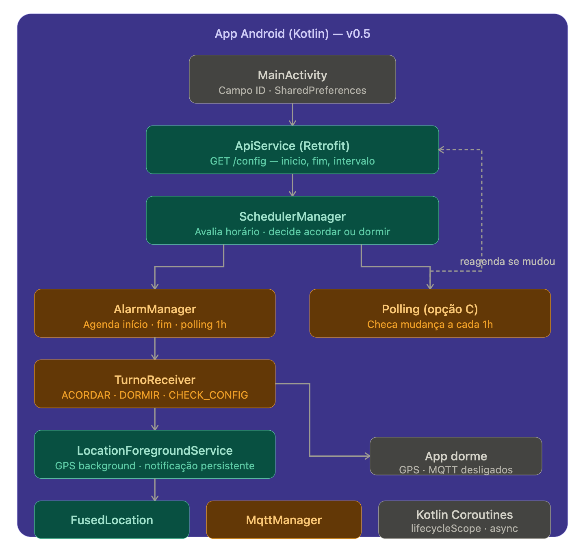

# Spec Técnica — App Android (Kotlin) · [POC Rastreamento de Entregadores](https://claude.ai/chat/16cda60c-4194-4047-bc85-60d8a2639e1e)

**Versão:** 0.5 · POC
**Plataforma:** Android (API 26+, Android 8.0 Oreo em diante)
**Linguagem:** Kotlin
**Objetivo:** Rastrear localização GPS dos entregadores em background e transmitir ao servidor central via MQTT para o broker EMQX rodando na VPS própria, respeitando o horário de trabalho configurado no servidor e economizando bateria fora do turno.

---

## 1. Visão geral

O app faz uma coisa: **coleta GPS e transmite apenas durante o horário de trabalho do entregador**, dormindo completamente fora desse período. O horário e o intervalo de envio são configurados no servidor — o app consulta via API ao confirmar o ID e a cada hora para detectar mudanças. Quando o servidor muda o horário, o app se reagenda automaticamente na próxima verificação periódica.




---

## 2. Funcionalidades do escopo da POC

| # | Funcionalidade | Prioridade |
|---|---|---|
| 1 | Campo de ID do entregador salvo como setting local | Must |
| 2 | Ao confirmar ID, consulta API e obtém horário e intervalos de envio | Must |
| 3 | App dorme completamente fora do horário de trabalho | Must |
| 4 | AlarmManager acorda e dorme o app nos horários configurados | Must |
| 5 | Polling leve a cada hora para detectar mudança de horário no servidor | Must |
| 6 | Rastreamento GPS em background com notificação persistente | Must |
| 7 | Envio de coordenadas via MQTT a cada 15s durante o turno | Must |
| 8 | Reconexão automática MQTT em queda de rede | Must |
| 9 | Indicador visual de status (ativo / dormindo / sem sinal) | Should |

**Fora do escopo da POC:** intervalo dinâmico por velocidade, FCM para acordar o app, batching de coordenadas, funcionamento offline, notificações de corrida, reinício automático após reboot.

---

## 3. Decisões técnicas registradas

### 3.1 MQTT em vez de HTTP para envio de GPS

HTTP abriria e fecharia uma conexão TCP a cada envio — em 4 horas de turno com envio a cada 15s isso representa ~960 handshakes TLS, com impacto direto na bateria. MQTT mantém uma conexão persistente durante todo o turno: o handshake acontece uma vez ao conectar, e cada envio subsequente é apenas o payload de ~100 bytes.

A mesma conexão MQTT já aberta permite que o servidor envie mensagens ao app em produção — ofertas de corrida, cancelamentos — sem polling nem Firebase FCM.

**Decisão: MQTT com HiveMQ SDK nativo. HTTP descartado para envio de GPS.**

### 3.2 EMQX instalado na VPS própria

Sem custo de serviço externo. O broker EMQX roda como container Docker na VPS própria, junto com o backend Node.js e o Redis. Open source, suporta milhões de conexões simultâneas, inclui dashboard web para monitorar conexões em tempo real.

### 3.3 FusedLocationProviderClient em vez de LocationManager

`LocationManager` é a API legada do Android — sem otimização de bateria, sem fusão de fontes (GPS + Wi-Fi + rede celular). `FusedLocationProviderClient` resolve tudo isso nativamente e é a API recomendada pelo Google desde Android 8.

### 3.4 ID do entregador como setting, não login

O entregador digita o ID uma vez. O app salva em `SharedPreferences`. Nas próximas aberturas o campo já vem preenchido. Sem sessão, sem token, sem tela de login.

### 3.5 Intervalo de envio e horário configurados no servidor

Nada é fixado no código do app. Ao confirmar o ID, o app consulta a API e recebe horário de início, fim e intervalos de envio. O app usa esses valores para se agendar via `AlarmManager` e para configurar o `FusedLocationProviderClient`.

**Justificativa do intervalo de 15 segundos para a POC:**
- A 30 km/h urbano, o entregador se move ~125 metros entre envios — margem aceitável para raio de busca de 3km no Redis
- 4h de turno = ~960 publicações MQTT de 100 bytes — impacto de bateria negligenciável
- Simples de implementar e depurar nos testes iniciais

**Referência do mercado:**

| App | Em movimento | Parado |
|---|---|---|
| Uber | 4-5s | 15-30s |
| iFood | 5-10s | 30-60s |
| POC (fase 1) | 15s fixo | 15s fixo |
| Produção (fase 2) | 10s | 30s |

### 3.6 Opção C — polling leve para detectar mudança de horário

Quando o servidor muda o horário de trabalho de um entregador, o app precisa saber. Foram avaliadas três opções:

**Opção A — FCM (Firebase Cloud Messaging):** servidor empurra notificação silenciosa para o app. Mais imediato, mas adiciona dependência do Firebase. Descartado para a POC.

**Opção B — MQTT:** servidor publica novo horário no topic do entregador. Funciona quando o app está ativo, mas não resolve quando está dormindo com MQTT desconectado. Descartado como solução única.

**Opção C — polling leve periódico (escolhida):** mesmo dormindo, o app acorda uma vez por hora via `AlarmManager`, faz um `GET` na API de configuração, compara com o horário salvo localmente e reagenda se necessário. Uma requisição HTTP por hora é desprezível em consumo de bateria. Simples, sem dependências externas, robusto.

A mudança de horário é percebida pelo app em no máximo 60 minutos — aceitável para a POC.

---

## 4. Arquitetura de componentes

### 4.1 `MainActivity`

Ponto de entrada. Responsável por:
- Exibir campo de ID pré-preenchido se já salvo
- Ao confirmar ID: salvar em `SharedPreferences`, consultar API e agendar o `AlarmManager`

```kotlin
class MainActivity : AppCompatActivity() {

    private val prefs by lazy {
        getSharedPreferences("tracker_prefs", MODE_PRIVATE)
    }

    override fun onCreate(savedInstanceState: Bundle?) {
        super.onCreate(savedInstanceState)

        val savedId = prefs.getString("entregador_id", "")
        campoId.setText(savedId)

        btnConfirmar.setOnClickListener {
            val id = campoId.text.toString().trim()
            if (id.isNotEmpty()) {
                prefs.edit().putString("entregador_id", id).apply()
                fetchConfigAndSchedule(id)
            }
        }
    }

    private fun fetchConfigAndSchedule(id: String) {
        lifecycleScope.launch {
            val config = apiService.getConfig(id)
            salvarConfigLocal(config)
            SchedulerManager.agendar(applicationContext, config)
        }
    }
}
```

### 4.2 API de configuração

Endpoint consultado ao confirmar ID e a cada hora pelo polling:

```
GET /api/entregadores/{id}/config

Resposta:
{
  "inicio_turno": "08:00",
  "fim_turno": "18:00",
  "intervalo_movimento_segundos": 15,
  "intervalo_parado_segundos": 30
}
```

Na POC o app usa `inicio_turno`, `fim_turno` e `intervalo_movimento_segundos`. O campo `intervalo_parado_segundos` é ignorado na POC mas já está no contrato — a API não muda na fase 2.

### 4.3 `SchedulerManager`

Responsável por toda a lógica de agendamento via `AlarmManager`. Calcula quanto tempo falta para o início e fim do turno e agenda os alarmes correspondentes. Também agenda o polling horário de verificação de configuração.

```kotlin
object SchedulerManager {

    fun agendar(context: Context, config: EntregadorConfig) {
        val agora = LocalTime.now()
        val inicio = LocalTime.parse(config.inicioTurno)
        val fim = LocalTime.parse(config.fimTurno)

        when {
            // Fora do turno, antes do início — agenda para acordar
            agora.isBefore(inicio) -> {
                agendarAcordar(context, inicio)
                agendarPolling(context)
            }
            // Dentro do turno — inicia rastreamento e agenda para dormir
            agora.isAfter(inicio) && agora.isBefore(fim) -> {
                iniciarService(context, config)
                agendarDormir(context, fim)
                agendarPolling(context)
            }
            // Após o fim do turno — agenda para o próximo dia
            agora.isAfter(fim) -> {
                agendarAcordar(context, inicio) // amanhã
                agendarPolling(context)
            }
        }
    }

    private fun agendarAcordar(context: Context, horario: LocalTime) {
        val intent = Intent(context, TurnoReceiver::class.java).apply {
            action = "ACTION_ACORDAR"
        }
        val pendingIntent = PendingIntent.getBroadcast(context, 0, intent, FLAG_IMMUTABLE)
        val alarmManager = context.getSystemService(AlarmManager::class.java)

        val msAteHorario = calcularMsAte(horario)
        alarmManager.setExactAndAllowWhileIdle(
            AlarmManager.RTC_WAKEUP,
            System.currentTimeMillis() + msAteHorario,
            pendingIntent
        )
    }

    private fun agendarDormir(context: Context, horario: LocalTime) {
        // Mesmo padrão — action "ACTION_DORMIR"
    }

    private fun agendarPolling(context: Context) {
        // Acorda a cada 60 minutos para checar mudança de config na API
        val intent = Intent(context, TurnoReceiver::class.java).apply {
            action = "ACTION_CHECK_CONFIG"
        }
        val pendingIntent = PendingIntent.getBroadcast(context, 1, intent, FLAG_IMMUTABLE)
        val alarmManager = context.getSystemService(AlarmManager::class.java)

        alarmManager.setInexactRepeating(
            AlarmManager.RTC_WAKEUP,
            System.currentTimeMillis() + 3_600_000L, // primeira verificação em 1h
            3_600_000L,                               // repete a cada 1h
            pendingIntent
        )
    }
}
```

**`setExactAndAllowWhileIdle`** para os alarmes de acordar/dormir — garante disparo preciso mesmo com o dispositivo em modo Doze (economia agressiva de bateria do Android).

**`setInexactRepeating`** para o polling — o Android pode atrasar alguns minutos para agrupar alarmes de vários apps e economizar bateria. Aceitável para verificação de configuração.

### 4.4 `TurnoReceiver`

`BroadcastReceiver` que recebe os disparos do `AlarmManager` e age conforme a ação:

```kotlin
class TurnoReceiver : BroadcastReceiver() {

    override fun onReceive(context: Context, intent: Intent) {
        val id = context.getSharedPreferences("tracker_prefs", MODE_PRIVATE)
            .getString("entregador_id", "") ?: return

        when (intent.action) {
            "ACTION_ACORDAR" -> {
                // Busca config atualizada e inicia o Service
                fetchConfigEIniciar(context, id)
            }
            "ACTION_DORMIR" -> {
                // Para o Service e desconecta MQTT
                context.stopService(Intent(context, LocationForegroundService::class.java))
            }
            "ACTION_CHECK_CONFIG" -> {
                // Polling leve — compara config do servidor com a salva localmente
                // Se mudou: cancela alarmes antigos e reagenda com novo horário
                fetchConfigEReagendar(context, id)
            }
        }
    }
}
```

**Fluxo do polling (Opção C):**

```
AlarmManager dispara ACTION_CHECK_CONFIG (a cada 1h)
  → GET /api/entregadores/{id}/config
  → Compara inicio_turno e fim_turno com o salvo em SharedPreferences
  → Se igual: não faz nada, volta a dormir
  → Se diferente:
      → Salva novo config em SharedPreferences
      → Cancela alarmes pendentes no AlarmManager
      → Chama SchedulerManager.agendar() com novo config
      → Reagenda tudo com os novos horários
```

Mudança de horário no servidor é percebida pelo app em no máximo 60 minutos.

### 4.5 `LocationForegroundService`

Idêntico à versão 0.4, com adição do comentário de fase 2 para intervalo dinâmico:

```kotlin
class LocationForegroundService : Service() {

    private lateinit var fusedLocationClient: FusedLocationProviderClient
    private lateinit var mqttManager: MqttManager
    private var intervaloMs: Long = 15_000L
    private var entregadorId: String = ""

    override fun onCreate() {
        super.onCreate()
        fusedLocationClient = LocationServices.getFusedLocationProviderClient(this)
        mqttManager = MqttManager.getInstance()
    }

    override fun onStartCommand(intent: Intent?, flags: Int, startId: Int): Int {
        entregadorId = intent?.getStringExtra("entregador_id") ?: ""
        intervaloMs = intent?.getLongExtra("intervalo_ms", 15_000L) ?: 15_000L

        startForeground(NOTIFICATION_ID, buildNotification())
        mqttManager.connect(entregadorId)
        startLocationUpdates()

        return START_STICKY
    }

    private fun startLocationUpdates() {
        val request = LocationRequest.Builder(
            Priority.PRIORITY_HIGH_ACCURACY,
            intervaloMs
        ).setMinUpdateIntervalMillis(intervaloMs / 2).build()

        fusedLocationClient.requestLocationUpdates(
            request,
            locationCallback,
            Looper.getMainLooper()
        )
    }

    private val locationCallback = object : LocationCallback() {
        override fun onLocationResult(result: LocationResult) {
            result.lastLocation?.let { location ->

                // POC: usa intervalo fixo configurado pelo servidor
                // Fase 2: intervalo dinâmico por velocidade
                // val intervaloAtual = if (location.speed > 1.5f) intervaloMovimento
                //                      else intervaloParado

                ServiceScope.launch {
                    mqttManager.publish(entregadorId, location)
                }
            }
        }
    }

    override fun onDestroy() {
        fusedLocationClient.removeLocationUpdates(locationCallback)
        mqttManager.disconnect()
        super.onDestroy()
    }
}
```

### 4.6 `MqttManager`

Sem alterações em relação à versão 0.4:

```kotlin
object MqttManager {

    private lateinit var client: Mqtt3AsyncClient

    fun connect(entregadorId: String) {
        client = MqttClient.builder()
            .useMqttVersion3()
            .serverHost("sua-vps.com")
            .serverPort(8883)
            .identifier("android-$entregadorId-${System.currentTimeMillis()}")
            .sslWithDefaultConfig()
            .automaticReconnect()
                .initialDelay(1, TimeUnit.SECONDS)
                .maxDelay(30, TimeUnit.SECONDS)
                .applyAutomaticReconnect()
            .buildAsync()

        client.connectWith()
            .keepAlive(60)
            .send()
    }

    suspend fun publish(entregadorId: String, location: Location) {
        val payload = LocationPayload(
            id = entregadorId,
            lat = location.latitude,
            lng = location.longitude,
            ts = System.currentTimeMillis() / 1000,
            speed = location.speed
        )

        client.publishWith()
            .topic("entregadores/$entregadorId/location")
            .payload(Json.encodeToString(payload).toByteArray())
            .qos(MqttQos.AT_LEAST_ONCE)
            .send()
    }

    fun disconnect() { client.disconnect() }
}
```

**Topics estruturados para crescer:**

```
entregadores/{id}/location   →  app publica GPS         (POC)
entregadores/{id}/corrida    ←  servidor envia oferta   (fase 2)
entregadores/{id}/cancel     ←  servidor envia cancel   (fase 2)
entregadores/{id}/config     ←  servidor empurra config (fase 2 — Opção B)
```

### 4.7 `AndroidManifest.xml`

```xml
<uses-permission android:name="android.permission.ACCESS_FINE_LOCATION"/>
<uses-permission android:name="android.permission.ACCESS_COARSE_LOCATION"/>
<uses-permission android:name="android.permission.ACCESS_BACKGROUND_LOCATION"/>
<uses-permission android:name="android.permission.FOREGROUND_SERVICE"/>
<uses-permission android:name="android.permission.FOREGROUND_SERVICE_LOCATION"/>
<uses-permission android:name="android.permission.INTERNET"/>
<uses-permission android:name="android.permission.RECEIVE_BOOT_COMPLETED"/>
<uses-permission android:name="android.permission.SCHEDULE_EXACT_ALARM"/>

<application>
    <service
        android:name=".service.LocationForegroundService"
        android:foregroundServiceType="location"
        android:exported="false"/>

    <receiver
        android:name=".receiver.TurnoReceiver"
        android:exported="false">
        <intent-filter>
            <action android:name="ACTION_ACORDAR"/>
            <action android:name="ACTION_DORMIR"/>
            <action android:name="ACTION_CHECK_CONFIG"/>
        </intent-filter>
    </receiver>
</application>
```

`SCHEDULE_EXACT_ALARM` é obrigatório desde Android 12 para usar `setExactAndAllowWhileIdle`. Em Android 12+ o usuário precisa conceder essa permissão manualmente em Configurações — o app deve guiar esse passo.

---

## 5. Dependências (Gradle)

```kotlin
dependencies {
    // GPS — FusedLocationProviderClient
    implementation("com.google.android.gms:play-services-location:21.2.0")

    // MQTT — HiveMQ SDK nativo Android/JVM
    implementation("com.hivemq:hivemq-mqtt-client:1.3.3")

    // Coroutines
    implementation("org.jetbrains.kotlinx:kotlinx-coroutines-android:1.7.3")

    // Serialização do payload JSON
    implementation("org.jetbrains.kotlinx:kotlinx-serialization-json:1.6.3")

    // Lifecycle
    implementation("androidx.lifecycle:lifecycle-service:2.7.0")
    implementation("androidx.lifecycle:lifecycle-viewmodel-ktx:2.7.0")

    // HTTP para polling de config (leve — só uma chamada por hora)
    implementation("com.squareup.retrofit2:retrofit:2.9.0")
    implementation("com.squareup.retrofit2:converter-gson:2.9.0")
}
```

**Nota:** Retrofit entra aqui exclusivamente para o polling de configuração — uma chamada HTTP simples por hora. O envio de GPS continua via MQTT. São responsabilidades distintas.

---

## 6. EMQX na VPS

```bash
docker run -d --name emqx \
  -p 1883:1883 \
  -p 8883:8883 \
  -p 18083:18083 \
  --restart always \
  emqx/emqx:latest
```

| Porta | Uso |
|---|---|
| 1883 | MQTT sem TLS — só testes internos |
| 8883 | MQTT com TLS — app usa essa |
| 18083 | Dashboard web de monitoramento |

**Como o backend consome os dados:**

```javascript
mqttClient.subscribe('entregadores/+/location')

mqttClient.on('message', (topic, payload) => {
    const { id, lat, lng } = JSON.parse(payload)
    redisClient.geoAdd('entregadores', {
        longitude: lng,
        latitude: lat,
        member: id
    })
})
```

**Quando chega um pedido:**

```bash
GEOSEARCH entregadores FROMMEMBER "loja_centro" BYRADIUS 3 km ASC
```

---

## 7. Fluxo completo

```
Entregador abre o app
  → Campo de ID (pré-preenchido se já usado antes)
  → Confirma ID
      → Salva em SharedPreferences
      → GET /api/entregadores/{id}/config
          → Recebe: inicio: 08:00, fim: 18:00, intervalo: 15s
      → SchedulerManager avalia horário atual

  Se agora < 08:00 (fora do turno):
      → AlarmManager agenda acordar às 08:00
      → AlarmManager agenda polling a cada 1h
      → App dorme — zero GPS, zero MQTT

  Se 08:00 < agora < 18:00 (dentro do turno):
      → Inicia LocationForegroundService
      → Notificação persistente "Rastreamento ativo"
      → MqttManager conecta no EMQX via TLS porta 8883
      → FusedLocationProvider registra callback a cada 15s
      → AlarmManager agenda dormir às 18:00
      → AlarmManager agenda polling a cada 1h
      → A cada 15s: publica MQTT → EMQX → Node.js → Redis GEOADD

  A cada 1h (polling):
      → GET /api/entregadores/{id}/config
      → Se horário igual: não faz nada
      → Se horário diferente: cancela alarmes → reagenda com novo horário

  Às 18:00:
      → TurnoReceiver recebe ACTION_DORMIR
      → Service parado → MQTT desconectado
      → AlarmManager agenda acordar às 08:00 de amanhã
      → App dorme
```

---

## 8. Tratamento de estados críticos

| Situação | Comportamento |
|---|---|
| App dormindo fora do turno | Zero consumo — GPS e MQTT completamente desligados |
| Android modo Doze | `setExactAndAllowWhileIdle` garante disparo do alarme de início de turno |
| Queda de rede durante turno | MqttManager reconecta com backoff 1s → 30s |
| Android mata o Service | `START_STICKY` reinicia automaticamente |
| Horário muda no servidor | App percebe em até 60 minutos via polling e reagenda |
| ROMs customizadas (MIUI, OneUI) | Podem matar AlarmManager agressivamente — risco operacional da POC |

---

## 9. Estrutura de pastas

```
app/src/main/
├── java/com/seuapp/tracker/
│   ├── MainActivity.kt
│   ├── service/
│   │   └── LocationForegroundService.kt
│   ├── mqtt/
│   │   └── MqttManager.kt
│   ├── receiver/
│   │   └── TurnoReceiver.kt
│   ├── scheduler/
│   │   └── SchedulerManager.kt
│   ├── api/
│   │   └── ApiService.kt
│   ├── model/
│   │   └── LocationPayload.kt
│   │   └── EntregadorConfig.kt
│   └── ui/
│       └── StatusScreen.kt
└── AndroidManifest.xml
```

---

## 10. Critérios de sucesso da POC

1. APK instalado em pelo menos 5 dispositivos Android diferentes funciona sem configuração além do ID
2. App dorme corretamente fora do horário configurado — zero consumo verificável
3. App acorda sozinho no horário de início sem intervenção do entregador
4. Coordenadas chegam ao Redis em menos de 15 segundos durante o turno
5. `GEOSEARCH` retorna entregadores corretos num raio configurável
6. Mudança de horário no servidor é percebida pelo app em até 60 minutos
7. Rastreamento sobrevive a pelo menos 4 horas contínuas sem interrupção

---

## 11. Evoluções futuras — fora do escopo da POC

Estas ideias foram avaliadas e registradas para referência futura. **Nenhuma delas entra na POC.**

### 11.1 FCM para acordar o app imediatamente (Opção A)

Quando o horário muda no servidor, em vez de esperar o polling de 1 hora, o servidor envia uma push notification silenciosa via Firebase Cloud Messaging. O app acorda, consulta a API e reagenda imediatamente. Latência de atualização cai de 60 minutos para segundos.

Requer: integração com Firebase, configuração de projeto no Google Console, `google-services.json` no app.

### 11.2 MQTT para empurrar config quando app está ativo (Opção B)

Quando o entregador está em turno e conectado ao broker, o servidor publica novo horário no topic `entregadores/{id}/config`. O app recebe e reagenda em tempo real. Complementa o FCM — FCM para quando está dormindo, MQTT para quando está ativo.

Requer: subscribe adicional no `MqttManager`, lógica de merge com config local.

### 11.3 Intervalo dinâmico por velocidade

Em movimento (`speed > 1.5 m/s`, equivalente a ~5 km/h): envia a cada 10s. Parado: envia a cada 30s. O código do `LocationForegroundService` já tem o comentário no lugar exato onde essa lógica entra — é só descomentar e ajustar.

Ganho estimado de bateria: 30-40% em turnos com muito tempo parado.

### 11.4 `PRIORITY_BALANCED_POWER_ACCURACY` quando parado

Troca GPS puro por fusão de Wi-Fi + rede celular quando o entregador está parado. Precisão cai de ~5 metros para ~100 metros — aceitável para um entregador aguardando na loja. Consumo de bateria cai significativamente.

Combinado com o intervalo dinâmico, os dois juntos representam a maior economia de bateria possível sem mudar a arquitetura.

### 11.5 Batching de coordenadas

Em vez de publicar uma mensagem MQTT a cada envio, acumula 3-5 coordenadas e envia em lote. Reduz o número de publicações sem perder dados históricos. O backend processa o array e atualiza o Redis com a posição mais recente.

Útil em cenários de sinal instável — o app acumula durante a instabilidade e envia quando a conexão estabiliza.

### 11.6 Reinício automático após reboot

Adicionar `RECEIVE_BOOT_COMPLETED` no manifest para que o `TurnoReceiver` seja disparado quando o celular reinicia. O receiver consulta o horário salvo localmente e reagenda os alarmes. Sem isso, se o entregador reiniciar o celular, o app não acorda no horário até que ele abra manualmente.